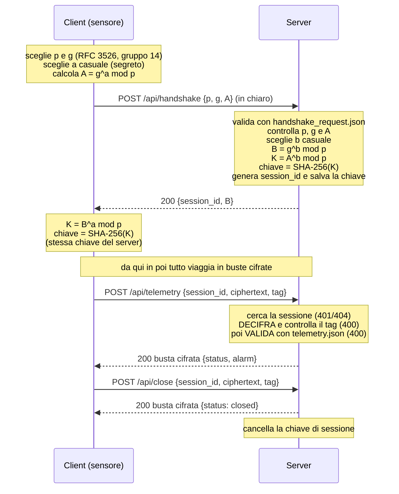

# FrigoTrack – Telemetria sicura per la catena del freddo

Prototipo client-server HTTP in cui sensori di temperatura inviano misure in JSON.
Il canale resta **HTTP** (niente HTTPS): la cifratura è a carico dell'applicazione.

- La chiave di sessione non viaggia mai in rete: viene concordata con **Diffie-Hellman** (gruppo 14 di RFC 3526, calcolo con `BigInteger.ModPow`).
- I messaggi sono cifrati con **AES-256-GCM** (la cifratura produce anche il `tag` di autenticazione).
- Ogni messaggio è validato con un **JSON Schema** (draft 2020-12) letto da file nella cartella `schemas/`.

## Struttura del repository

```
├── server/            server HTTP (HttpListener)
│   ├── Program.cs
│   ├── server.csproj
│   └── schemas/       error, handshake_request, readings_request,
│                      readings_response, telemetry  (.json)
├── client/            simulatore di 3 sensori
│   ├── Program.cs
│   ├── client.csproj
│   └── schemas/       (stessi 5 file)
├── README.md
└── RELAZIONE.md       scelte tecniche e limiti noti
```

## Requisiti

- .NET SDK 8 (`brew install --cask dotnet-sdk` su macOS)
- Visual Studio Code con l'estensione *C# Dev Kit* (facoltativa, bastano i comandi `dotnet`)
- Connessione a internet al primo avvio, per scaricare il pacchetto `JsonSchema.Net`

## Avvio

Servono due terminali (o due finestre di VS Code). Il **server va avviato per primo**.

```bash
# 1. Server (ascolta su http://127.0.0.1:11111/)
cd server
dotnet run

# 2. Client (3 sensori, 3 giri di misure ogni 2 secondi)
cd client
dotnet run
```

Le misure valide vengono salvate dal server nel file `readings.jsonl` (una misura JSON per riga), creato nella cartella da cui parte l'eseguibile.

> Nota macOS: la porta 5000 è usata da AirPlay Receiver, per questo il server usa la **11111**.

## Cosa fa il client

1. Esegue l'handshake e ricava la chiave (prima di inviare qualsiasi dato).
2. Simula 3 sensori (`CELLA-BG-001` pharma, `CAMION-MI-002` food, `CELLA-BS-003` frozen) che inviano una misura ciascuno per 3 giri.
3. Prova una misura non valida: la blocca il client (validazione prima di cifrare) e poi la invia saltando il controllo per mostrare il rifiuto del server.
4. Chiede l'elenco delle misure di un sensore (`/api/readings`).
5. Invia una busta manomessa e una con sessione inesistente.
6. Chiude la sessione (`/api/close`).

## Diagramma di sequenza dell'handshake



Solo `p`, `g`, `A`, `B` e `session_id` viaggiano in chiaro: sono valori pubblici. Il segreto `a` e `b` e la chiave `K` non lasciano mai client e server.

## Cifratura e busta

La chiave AES-256 è lo SHA-256 del segreto condiviso `K`.
Ogni messaggio dopo l'handshake viaggia in una busta con tre campi:

```json
{
  "session_id": "a3f9c2e1",
  "ciphertext": "<Base64 di: nonce (12 byte) + dati cifrati>",
  "tag": "<Base64 del tag GCM, 16 byte>"
}
```

Il nonce di 12 byte, casuale per ogni messaggio, è messo davanti ai dati cifrati dentro il campo `ciphertext`.

**Regola di sicurezza:** il server prima *decifra*, poi *valida*. Se la decifratura o il tag falliscono risponde `400` senza elaborare nulla.

## Endpoint e messaggi

Tutti gli endpoint usano il metodo **POST**.

| Endpoint | Corpo della richiesta | Risposta (200) | Schema |
|---|---|---|---|
| `/api/handshake` | `{p, g, A}` in chiaro (esadecimale) | `{session_id, B}` in chiaro | `handshake_request.json` |
| `/api/telemetry` | busta cifrata con la misura | busta cifrata con `{status, alarm, message?}` | `telemetry.json` |
| `/api/readings` | busta cifrata con `{sensor_id, from?, to?}` | busta cifrata con `{count, readings[]}` | `readings_request.json`, `readings_response.json` |
| `/api/close` | busta cifrata (qualsiasi oggetto JSON) | busta cifrata con `{status: "closed"}` | – |

Gli errori di validazione hanno forma `{"error": "..."}` (schema `error.json`), cifrati se la sessione è valida.

### Handshake

Richiesta:
```json
{ "p": "FFFFFFFF...(2048 bit, esadecimale)", "g": "2", "A": "3B1F...(esadecimale)" }
```
Risposta:
```json
{ "session_id": "a3f9c2e1", "B": "9C42...(esadecimale)" }
```

### Misura (`/api/telemetry`, prima di cifrare)

```json
{
  "sensor_id": "CELLA-BG-007",
  "timestamp": "2026-11-02T08:15:30Z",
  "cargo_type": "pharma",
  "temperature_c": 4.6,
  "humidity": 55,
  "battery": 87
}
```

Campi obbligatori: `sensor_id`, `timestamp`, `cargo_type`, `temperature_c`. Vincoli principali:

| Campo | Vincolo |
|---|---|
| `sensor_id` | stringa, pattern `^[A-Z]+-[A-Z]{2}-[0-9]{3}$` |
| `timestamp` | stringa, `format: date-time` |
| `cargo_type` | `food`, `pharma` oppure `frozen` |
| `temperature_c` | numero tra -40 e 40 |
| `humidity` | numero tra 0 e 100 (facoltativo) |
| `battery` | intero tra 0 e 100 (facoltativo) |
| altri campi | non ammessi (`additionalProperties: false`) |

Risposta (dopo la decifratura):
```json
{ "status": "ok", "alarm": false }
```
Se la temperatura esce dall'intervallo di sicurezza:
```json
{ "status": "ok", "alarm": true, "message": "temperatura 15 fuori dall'intervallo 2..8 per pharma" }
```

| Merce | Intervallo di sicurezza |
|---|---|
| `pharma` | 2 – 8 °C |
| `food` | 0 – 6 °C |
| `frozen` | da -25 a -15 °C |

### Elenco misure (`/api/readings`)

Richiesta (`from` e `to` facoltativi, in formato date-time):
```json
{ "sensor_id": "CELLA-BG-001", "from": "2026-11-02T00:00:00Z", "to": "2026-11-02T23:59:59Z" }
```
Risposta:
```json
{ "count": 1, "readings": [ { "sensor_id": "CELLA-BG-001", "timestamp": "...", "cargo_type": "pharma", "temperature_c": 4.6 } ] }
```

### Messaggio di errore

```json
{ "error": "descrizione dell'errore, con il campo sbagliato" }
```

## Codici HTTP

| Codice | Quando |
|---|---|
| 200 | operazione riuscita |
| 400 | JSON non valido, messaggio che non rispetta lo schema (l'errore indica il campo), busta non valida o manomessa, decifratura o tag falliti |
| 401 | `session_id` mancante nella busta |
| 404 | endpoint inesistente oppure sessione inesistente (anche dopo `/api/close`) |
| 501 | metodo diverso da POST |
| 500 | errore interno del server |
