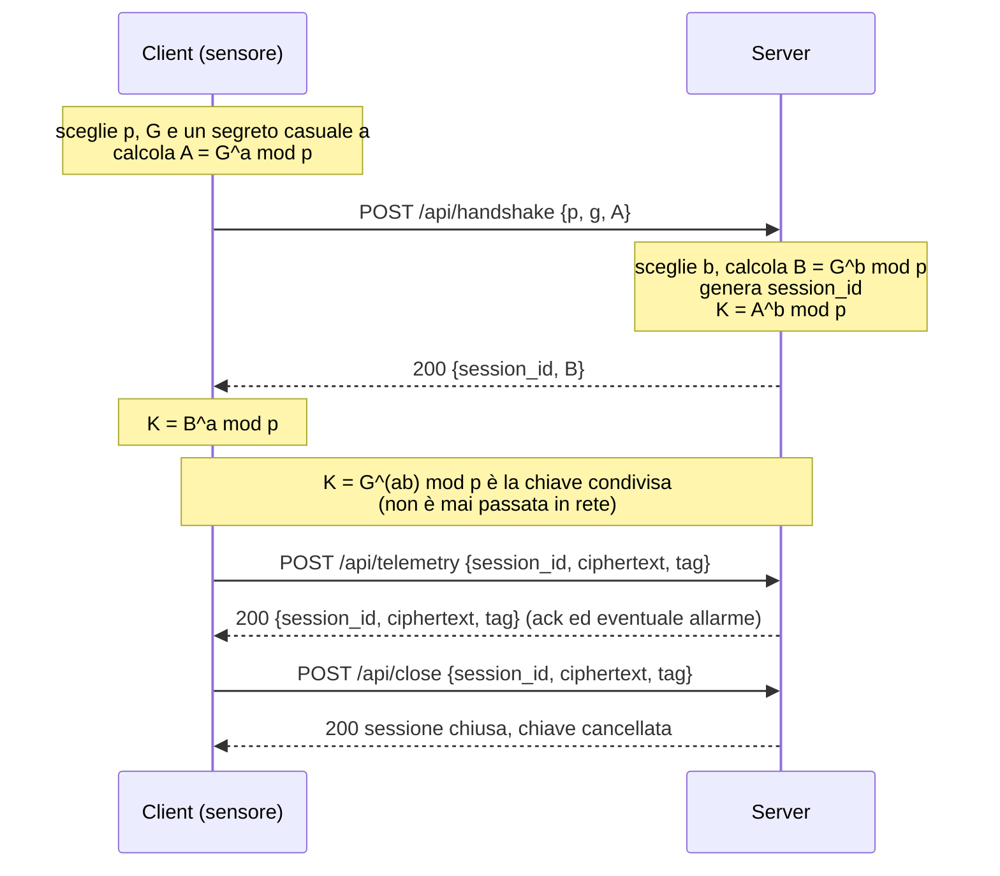

# FrigoTrack – Telemetria sicura per la catena del freddo

Prototipo client-server HTTP in cui dei sensori di temperatura inviano misure in formato JSON a una piattaforma centrale. I messaggi sono **cifrati dall'applicazione** con una chiave concordata tramite **Diffie-Hellman** e **validati con JSON Schema**.

Progetto individuale – classe 5IB, TEP.

## Scenario

FrigoTrack S.r.l. trasporta alimenti freschi e farmaci termosensibili. Ogni cella frigorifera e ogni camion ha un sensore che invia temperatura e umidità a una piattaforma centrale. Oggi i dati viaggiano in chiaro: chiunque potrebbe leggerli o alterarli. Questo prototipo risolve il problema rispettando tre vincoli:

- il canale resta **HTTP** (niente HTTPS): la cifratura è a carico dell'applicazione;
- la chiave **non viaggia mai in rete**: viene concordata con Diffie-Hellman;
- ogni messaggio ha un formato rigoroso, verificato con **JSON Schema**.

## Struttura del repository

```
.
├── server/          # server di raccolta dati
├── client/          # client che simula i sensori
├── schemas/         # JSON Schema (uno per tipo di messaggio)
├── tests/           # test automatici
├── data/            # misure salvate dal server (file JSON)
├── RELAZIONE.md     # scelte tecniche e limiti noti
└── README.md
```

> Adatta i nomi delle cartelle e dei file alla struttura reale del repository.

## Requisiti e avvio

```bash
# 1. installa le dipendenze
pip install -r requirements.txt      # oppure: npm install

# 2. avvia il server
python server/server.py              # oppure: node server/server.js

# 3. in un altro terminale, avvia il client (3 sensori)
python client/client.py              # oppure: node client/client.js

# 4. esegui i test
pytest                               # oppure: npm test
```

> Sostituisci i comandi con quelli del linguaggio effettivamente usato.

## Come funziona

### 1. Handshake (Diffie-Hellman)

Il client e il server concordano una chiave condivisa senza mai trasmetterla.



Il calcolo di `A`, `B` e `K` è implementato direttamente nel codice, usando la potenza modulare del linguaggio (`pow(base, exp, mod)`), senza librerie che eseguano l'intero scambio. Si usa un gruppo noto (es. RFC 3526).

### 2. Scambio di messaggi cifrati

Dopo l'handshake ogni messaggio viaggia in una **busta**. In rete l'unico dato in chiaro è il `session_id`:

```json
{
  "session_id": "a3f9c2e1",
  "ciphertext": "mH3t...Base64...==",
  "tag": "8dK2...Base64...=="
}
```

Regola di sicurezza del server: **prima decifra, poi valida**. Se la decifratura o il tag falliscono, risponde `400` senza elaborare nulla.

## Endpoint

| Endpoint | Metodo | Corpo | Risposta |
|---|---|---|---|
| `/api/handshake` | POST | `p`, `g`, chiave pubblica del client `A` (in chiaro) | `session_id`, chiave pubblica del server `B` |
| `/api/telemetry` | POST | busta cifrata con la misura del sensore | busta cifrata con ack ed eventuale allarme |
| `/api/readings` | POST | busta cifrata con la richiesta (sensore, intervallo) | busta cifrata con l'elenco delle misure |
| `/api/close` | POST | busta cifrata | chiusura sessione e cancellazione della chiave |

### Codici HTTP

| Codice | Significato |
|---|---|
| 200 | operazione riuscita |
| 400 | messaggio non valido (schema violato, busta manomessa, tag errato) |
| 401 | sessione non autorizzata / chiave non valida |
| 404 | sessione o risorsa inesistente |

## Messaggio applicativo

Esempio di misura inviata da un sensore (prima della cifratura):

```json
{
  "sensor_id": "CELLA-BG-007",
  "timestamp": "2026-11-02T08:15:30Z",
  "cargo_type": "pharma",
  "temperature_c": 4.6,
  "humidity": 55,
  "battery": 87
}
```

| Campo | Tipo | Vincoli |
|---|---|---|
| `sensor_id` | string | pattern `^[A-Z]+-[A-Z]{2}-[0-9]{3}$` |
| `timestamp` | string | formato `date-time` |
| `cargo_type` | string | `food`, `pharma`, `frozen` |
| `temperature_c` | number | da -40 a 40 |
| `humidity` | number | da 0 a 100 (opzionale) |
| `battery` | integer | da 0 a 100 (opzionale) |

### Allarmi

Il server segnala un allarme nella risposta quando la temperatura esce dall'intervallo di sicurezza del tipo di merce (es. farmaci tra 2 e 8 °C).

## JSON Schema

Nella cartella `schemas/` c'è uno schema (draft 2020-12) per ogni tipo di messaggio, con vincoli reali (`type`, `required`, `enum`, `minimum`/`maximum`, `pattern`, `format`, `additionalProperties: false`):

| File | Messaggio |
|---|---|
| `handshake_request.json` | richiesta di handshake |
| `handshake_response.json` | risposta di handshake |
| `telemetry.json` | misura del sensore |
| `telemetry_ack.json` | conferma ed eventuale allarme |
| `readings_request.json` | richiesta delle misure (sensore, intervallo) |
| `readings_response.json` | elenco delle misure |
| `error.json` | messaggio di errore (indica il campo sbagliato) |

> Allinea questa tabella ai file realmente presenti.

Un messaggio non valido viene rifiutato con un errore che indica il campo errato.

## Test

I test coprono almeno questi casi:

1. handshake riuscito
2. messaggio valido
3. messaggio non valido
4. busta manomessa
5. sessione inesistente

## Limiti noti

Vedi la relazione (`RELAZIONE.md`). In sintesi, il prototipo non protegge da attacchi man-in-the-middle sull'handshake (le chiavi pubbliche non sono autenticate) e usa il segreto condiviso direttamente come chiave simmetrica.

## Autore

Nome Cognome – 5IB
